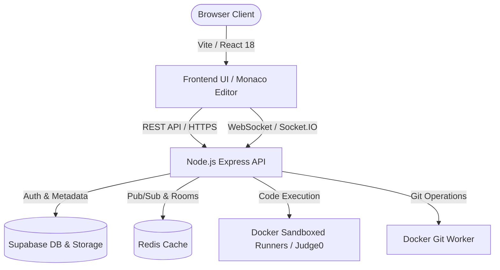

<div align="center">

# ☁️ CloudCodeX

### Next-Generation Cloud IDE & Real-Time Collaborative Code Execution Engine

[](LICENSE)
[](https://github.com/ash-ftw/CloudCodex/stargazers)
[](https://github.com/ash-ftw/CloudCodex/network/members)
[](https://cloudcodex.vercel.app/)
[](https://www.typescriptlang.org/)
[](https://react.dev/)
[](https://nodejs.org/)
[](https://www.docker.com/)
[](https://github.com/ash-ftw/CloudCodex/pkgs/container/cloudcodex-worker)

[**Explore Live Demo »**](https://cloudcodex.vercel.app/) · [Report Bug](https://github.com/ash-ftw/CloudCodex/issues) · [Request Feature](https://github.com/ash-ftw/CloudCodex/issues)

</div>

---

## 🌟 Overview

**CloudCodeX** is a full-featured, browser-based cloud IDE designed for fast, isolated, and collaborative development. Powered by Monaco Editor, React, Node.js/Express, and sandboxed Docker runners, CloudCodeX allows developers to write, compile, execute, and collaborate on code across 11+ programming languages in real time.

Whether you're building a multi-file project, running untrusted code in secure execution sandboxes, or pair programming with remote teammates, CloudCodeX provides an end-to-end cloud environment with zero local setup.

---

## ✨ Features

- ⚡ **Multi-Language Sandboxed Execution**: Run code in secure, isolated Docker containers or Judge0 instances across C, C++, Java, Python, JavaScript, TypeScript, Go, Rust, PHP, Ruby, and Bash.
- 👥 **Real-Time Collaboration**: Live multi-user cursor presence, real-time file buffer synchronisation, user selection highlighting, and one-click "jump-to-collaborator" navigation.
- 🔐 **Granular Role-Based Access Control (RBAC)**: Workspace roles (`owner`, `editor`, `viewer`) and shareable Room IDs with optional password protection.
- 🕒 **Point-in-Time Version History**: File snapshots with built-in visual diffing and one-click restoration.
- 🐙 **Integrated Git Worker**: Dedicated Docker worker executing remote repository clones, commits, branches, and push operations.
- 💻 **Monaco Editor Experience**: Full syntax highlighting, auto-completion, multi-tab navigation, customizable themes, and terminal streaming via Socket.IO.
- 🗄️ **Supabase Cloud Storage & Auth**: Persistent workspace and file storage with Row-Level Security (RLS) and social OAuth integrations.

---

## 🏛️ Architecture



---

## 🛠️ Tech Stack

| Layer | Technologies |
|---|---|
| **Frontend** | React 18, Vite, TypeScript, Tailwind CSS, Monaco Editor, Lucide Icons, Socket.IO Client |
| **Backend** | Node.js, Express, TypeScript, Socket.IO, Dockerode, Axios, Redis |
| **Storage & Auth** | Supabase (PostgreSQL, Storage, RLS, OAuth), Redis |
| **Sandbox Execution** | Docker Engine, Judge0 API / OnlineCompiler fallback |
| **Hosting** | Vercel (Frontend & SPA Rewrites), Render / VPS / Docker (Backend & Runners) |

---

## 🚀 Quick Start

### Prerequisites
- [Node.js](https://nodejs.org/) (v18.0.0 or higher)
- [npm](https://www.npmjs.com/) (v9 or higher)
- [Docker Engine](https://docs.docker.com/engine/install/) (for local containerized execution)
- [Supabase](https://supabase.com/) account (or local Supabase CLI)

### 1. Clone the Repository
```bash
git clone https://github.com/ash-ftw/CloudCodex.git
cd CloudCodex
```

### 2. Install Dependencies
```bash
npm run install:all
```

### 3. Setup Environment Variables
Copy `.env.example` into root or `server/.env`:
```bash
cp .env.example .env
```
Fill in your credentials:
- `SUPABASE_URL` and `SUPABASE_ANON_KEY`
- `SUPABASE_SERVICE_ROLE_KEY`
- `JWT_SECRET`
- OAuth and SMTP credentials (optional for basic local dev)

### 4. Database Setup
Execute the following SQL schemas in your Supabase SQL Editor:
1. `supabase_schema.sql` (Core users and workspaces)
2. `supabase_storage_setup.sql` (Storage buckets and RLS policies)
3. `admin_schema_migration.sql` (Admin controls)
4. `collaboration_schema_migration.sql` (Real-time rooms & snapshots)

### 5. Build Execution Sandboxes (Optional for Docker Mode)
Build the language execution images locally:
```bash
# On Linux / macOS
npm run docker:build-images:linux

# On Windows (PowerShell)
npm run docker:build-images:windows
```

### 6. Run Development Environment
```bash
npm run dev
```

The services will start at:
- **Client Application**: [http://localhost:5173](http://localhost:5173)
- **Backend API Server**: [http://localhost:3001](http://localhost:3001)
- **Marketing Landing Page**: [http://localhost:5173/landing](http://localhost:5173/landing)

---

## 🐳 Docker Compose Quickstart

Alternatively, run the complete local stack using Docker Compose:
```bash
docker-compose up --build
```

### Pre-Built Worker Container (GHCR)
The CloudCodeX sandboxed worker is published on the GitHub Container Registry:
```bash
docker pull ghcr.io/ash-ftw/cloudcodex-worker:latest
```

---

## 📦 Project Structure

```
CloudCodex/
├── .github/              # Issue templates, PR templates, and CI workflows
├── client/               # React + Vite frontend SPA
│   ├── src/components/   # Editor, FileTree, Collaborators, Terminal, Modals
│   ├── src/hooks/        # Custom React hooks (useCollab, useExecution)
│   └── src/store/        # Zustand state stores
├── server/               # Express + TypeScript backend API
│   ├── src/config/       # Environment & Docker configuration
│   ├── src/controllers/  # API endpoints for files, workspaces, execution
│   ├── src/middleware/   # Authentication, validation, and rate limiting
│   ├── src/routes/       # Express route handlers
│   └── src/services/     # Docker execution, Supabase storage, Socket handlers
├── docker/               # Dockerfiles for execution sandboxes and git worker
├── landing/              # Static marketing and landing page assets
├── .env.example          # Template for required environment variables
└── README.md
```

---

## 🤝 Contributing

Contributions make the open-source community an amazing place to learn, inspire, and create. Any contributions you make are **greatly appreciated**.

Please see [CONTRIBUTING.md](CONTRIBUTING.md) for details on our code of conduct and development workflow.

1. Fork the Project
2. Create your Feature Branch (`git checkout -b feature/AmazingFeature`)
3. Commit your Changes (`git commit -m 'feat: add some amazing feature'`)
4. Push to the Branch (`git push origin feature/AmazingFeature`)
5. Open a Pull Request

---

## 🛡️ Security & Vulnerability Reporting

Please review our [SECURITY.md](SECURITY.md) to report vulnerabilities responsibly. Do **not** open public issues for sensitive security vulnerabilities.

---

## 📜 License

Distributed under the MIT License. See [LICENSE](LICENSE) for more information.

---

## 👤 Author & Maintainer

**Ashish Jacob** ([@ash-ftw](https://github.com/ash-ftw))
- GitHub: [ash-ftw](https://github.com/ash-ftw)
- Live Project: [cloudcodex.vercel.app](https://cloudcodex.vercel.app/)
